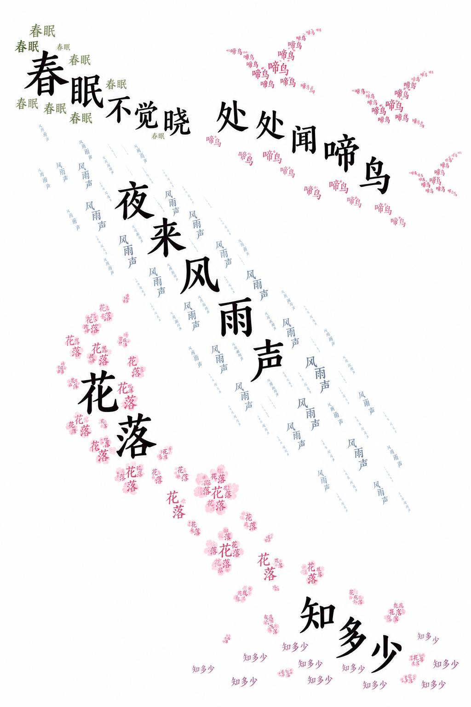
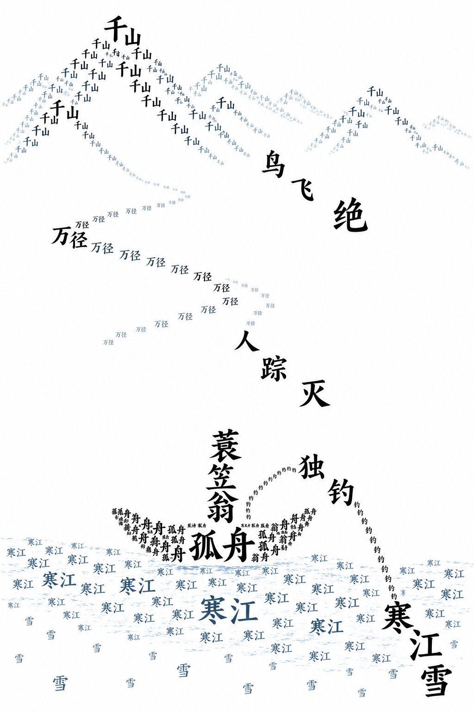

# 诗词文字画 · Poetry Typography Skill

把一首诗变成一幅只由诗中文字组成的图。字的位置和走向就是画面：既能看出意象，也能沿路径读完整首诗。

用于亲子诗词学习、中文文字画与具体诗创作。核心方法来自作者提供的“辅导孩子学习诗词 Prompt”，并结合五首诗的实际试作整理为 Agent Skill。

## 使用

将仓库克隆到 Codex 的 skills 目录，文件夹命名为 `poetry-typography`：

```sh
git clone https://github.com/zhangswings/poetry-typography-skill.git ~/.codex/skills/poetry-typography
```

开始新的会话后调用：

```text
请用 $poetry-typography 把《江雪》变成一幅只由原诗文字组成的图片。
先找事实，再确定字词与意象的映射、空间关系和全文阅读路径。
生成后逐条检查，发现问题就修正。
```

需要支持图片生成的 Agent 环境。没有图片生成能力时，应明确说明，不能把文字提示词冒充图片。

## 四步方法

1. **找事实**：找出诗里有哪些事物，以及上下、远近、运动、否定和想象关系，不添加诗外景物。
2. **定投影**：只用对应字词组成对应意象；垂下沿弧线，高处向上叠，风斜穿；疑问、否定与比喻放在留白或交界处。
3. **排出来**：生成纯文字图片，主阅读路径保留原诗全文和原序。
4. **对照检查**：检查字库、可辨认的画面、完整读序、意象与字词的对应关系；不满足就返修。

## 参考案例

以下是本次五首诗试作中选出的三个较好的构图版本，均由内置 imagegen 生成。**这些是构图参考，不是已通过全部检查的教学定稿。** 缩小后的纹理字难以逐字核对，使用前应查看原图；模型写进提示词的要求不等于图片已经满足要求。

### 《春晓》· 孟浩然

春眠不觉晓，处处闻啼鸟。夜来风雨声，花落知多少。

鸟鸣散在上方，风雨斜穿画面，落花向下弯曲，“知多少”留在空白处。大字提供全文读序，较浅的小字重复对应意象。



### 《江雪》· 柳宗元

千山鸟飞绝，万径人踪灭。孤舟蓑笠翁，独钓寒江雪。

“千山”起伏成峰，“万径”伸向远处，山径与孤舟之间留出大片空白。没有把“鸟飞绝”画成飞鸟群。仍需重点检查“孤舟→蓑笠翁”的衔接是否足够清楚，以及极小纹理是否混入非文字笔画。



### 《登鹳雀楼》· 王之涣

白日依山尽，黄河入海流。欲穷千里目，更上一层楼。

白日依山，黄河向海弯曲，末句自下而上登楼。此版已修复首稿漏掉“一”、把“欲穷千里目”铺成山形的问题。抽象愿望放在留白中，楼体用“层楼”构成。


## 检查标准与实际限制

- 图中每个字都出自原诗；可以重复，不能出现错字或伪字。
- 不看原诗的人也能认出主要画面。
- 沿明确路径可以把全文一字不差地读下来。
- 每个意象仅由指称或描写它的字构成，不能拿无关字填充。

图像生成能较快探索构图，但文字准确性仍需人工核验。另两首试作没有作为展示案例上传：《九月九日忆山东兄弟》的“萸”反复出现错误字形；《春江花月夜》长卷出现局部意象用字错配。Skill 记录了这些问题，并要求如实标记未通过的草稿。连续定向返修无改善时，应说明限制并提出真实字体排版方案，不能谎称完成或无限重试。

## 文件

- [SKILL.md](SKILL.md)：可复用工作流程与四项检查要求。
- [构图提示词和案例说明](references/composition.md)：提示词骨架、三首短诗的投影方式及试作教训。
- [agents/openai.yaml](agents/openai.yaml)：Codex 的技能显示信息。
- [examples](examples)：README 展示的三张原图。

诗词原文属于古典作品；示例图片为 AI 生成。仓库不包含工作区中的内部业务文件、账号信息或其他私人资料。
